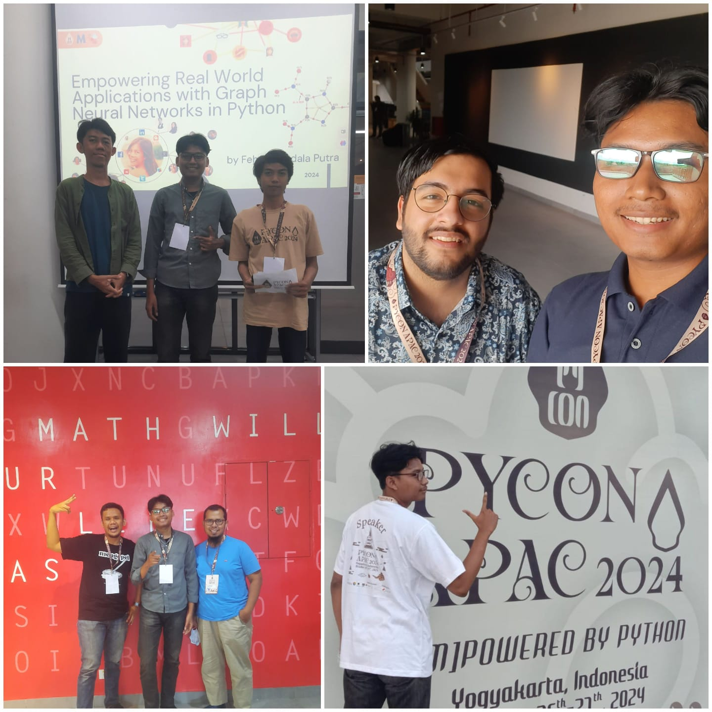
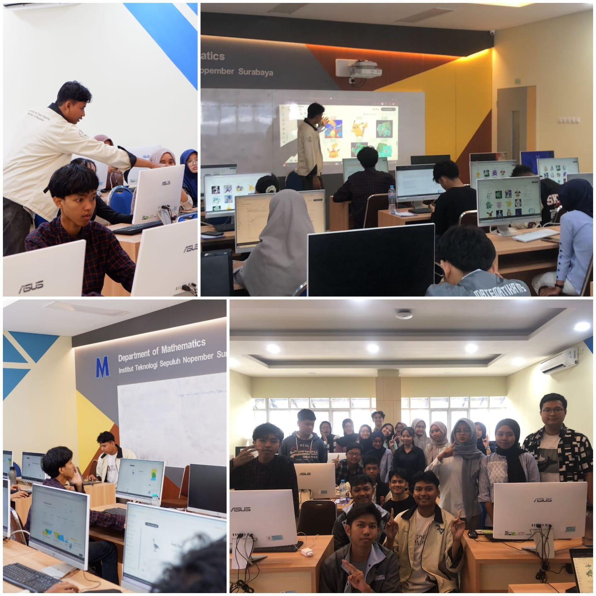

I'm a freelance software engineer and AI enthusiast currently working with G2i Inc and Aligner. With a strong mathematical background, I develop innovative solutions at the intersection of AI, machine learning, and software development.

## 🎤 Featured Talks

  

    
    
<strong>Graph Neural Networks in Python</strong> 
    PyCon APAC 2024, Yogyakarta 
    <a href="https://www.youtube.com/live/Wk6hkMFasCE?si=myR23EIfLWV61abf">[Watch Presentation]</a>

  

  

    
    
<strong>Machine Learning Workshop</strong> 
    Computer Vision Lab, ITS, Surabaya

  

## 🎓 Education

Third-year undergraduate in Mathematics at Institute Technology Sepuluh Nopember (ITS), applying mathematical principles to advanced computing and AI projects.

## 🛠️ Skills & Expertise

### 🤖 AI & Machine Learning
- Natural Language Processing (NLP) and Computer Vision algorithm development
- Model fine-tuning with TensorFlow, Keras, PyTorch, and scikit-learn
- End-to-end ML pipeline deployment on Google Cloud Platform

### 💻 Software Engineering
- Full-stack development with modern frameworks
- Containerization with Docker and orchestration with Kubernetes
- Workflow optimization with MLflow and version control (Git/DVC)

### 📊 Data Science
- Data analysis and visualization (Pandas, NumPy, Seaborn, Matplotlib)
- Distributed computing for large-scale data processing (Dask)
- Statistical modeling and mathematical optimization

## 🌟 Recent Projects

I'm constantly working on projects that combine mathematical modeling with machine learning applications. My recent work includes:
- Graph Neural Network implementations for recommendation systems
- Natural language understanding models for complex text analysis

## 📚 Continuous Learning

As technology evolves rapidly, I stay at the cutting edge through research, collaboration, and hands-on experimentation with emerging AI techniques and frameworks.

---

Feel free to reach out if you'd like to collaborate on projects at the intersection of mathematics, AI, and software engineering.