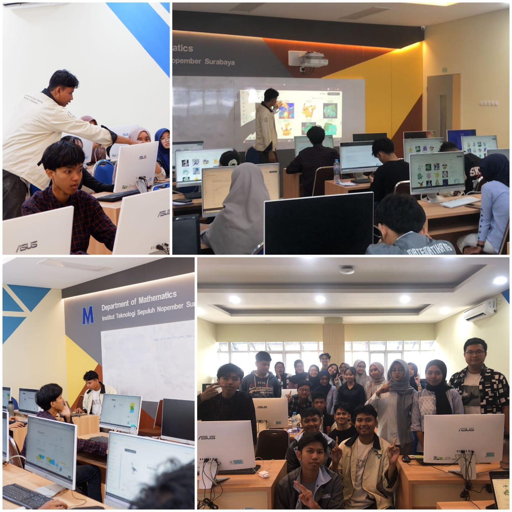

Computer Vision Laboratory 1
19 January 2025
01:00 PM - 03:00 PM

   

Resources: 
[Demo Notebook](https://www.kaggle.com/code/fehruputra/demo-workshop) \
[Complete Notebook](https://www.kaggle.com/code/fehruputra/pokemon-classification)

Have you ever wondered how AI can recognize images? In this engaging workshop designed for high school students, you'll dive into the fascinating world of Computer Vision and Image Classification through a fun and relatable example - Pokemon classification! Using game-like analogies and simple concepts, participants will understand how AI "learns" to recognize images, similar to how humans learn to identify objects through their characteristics.

This workshop bridges theory and practice in an entertaining way, helping participants grasp AI Vision technology that's increasingly relevant in our digital era. Through live demonstrations using a Pokemon Classifier, students will witness firsthand how machine learning models process and classify images. The workshop includes interactive quizzes and hands-on sessions where participants will try creating their own AI models, making the learning experience both educational and enjoyable.

We'll explore how AI processes images, understand the concepts of datasets and model training, and discover practical applications of Computer Vision in daily life - from Instagram filters to Face ID on phones, and even future technologies like self-driving cars and medical imaging. The workshop also includes bonus examples of Anime Faces Classification and K-pop Artist Face Classification, demonstrating the versatility of image classification techniques.

No coding experience is required - just bring a laptop with internet connection and enthusiasm to learn about AI! This workshop is specifically structured to make complex concepts accessible to high school students while maintaining their engagement through interactive elements and real-world applications.
