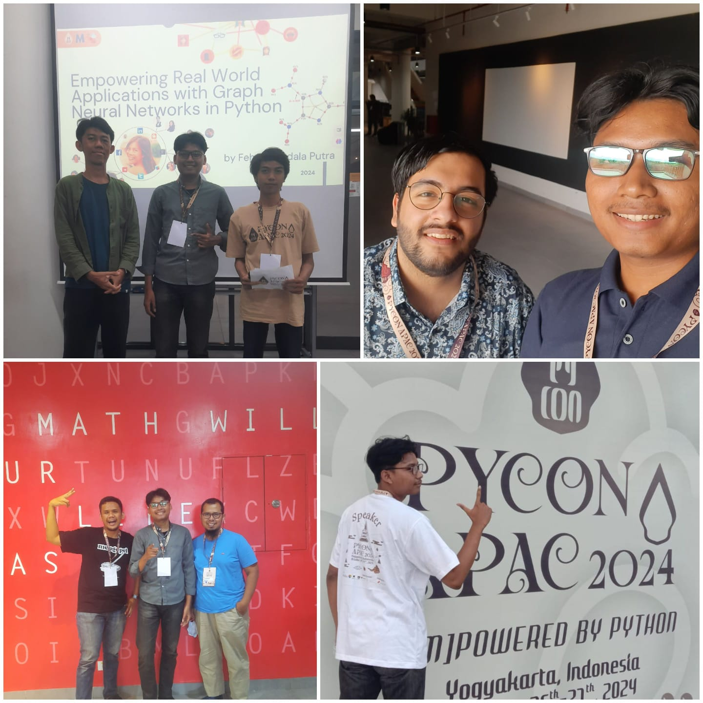

Class #6 - 3C
27 October 2024
02:00 PM - 02:30 PM

  

Video: [Youtube](https://www.youtube.com/watch?v=fe917FASuPE) \
Resources: [Github](https://www.youtube.com/watch?v=fe917FASuPE)

Graph Neural Networks (GNNs) are revolutionizing how we handle complex data structures in various domains, from social networks to molecular biology. In this talk, we will explore how Python can harness the power of GNNs to solve real-world problems. Attendees will learn the fundamentals of GNNs, practical applications, and how to implement these networks using Python libraries. 

This session aims to empower developers to leverage GNNs in their projects, enhancing their ability to analyze and interpret intricate data patterns. In this 30-minute talk, we will delve into the world of Graph Neural Networks (GNNs) and their practical applications in solving real-world problems. 

The session will begin with an introduction to the core concepts of GNNs, highlighting their unique ability to process and analyze graph-structured data. We will then explore several case studies demonstrating how GNNs can be applied in various fields, such as social network analysis, recommendation systems, and bioinformatics. Participants will gain hands-on knowledge of implementing GNNs using popular Python libraries, including PyTorch Geometric. 

The talk will also cover best practices for designing and training GNN models, addressing common challenges, and optimizing performance. By the end of the session, attendees will have a solid understanding of GNNs and be equipped with practical skills to apply them in their own projects.
